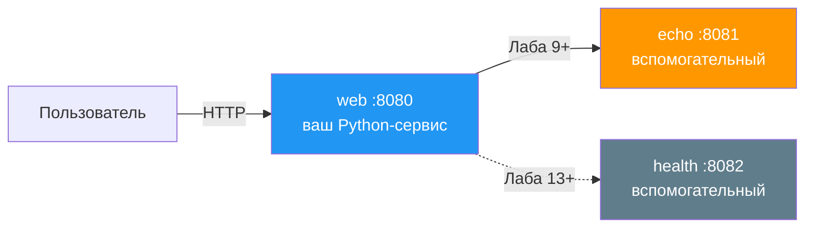
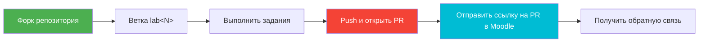

# DevOps-инжиниринг: ключевые практики


Освойте **DevOps промышленного уровня** на практических лабораторных работах. Вы берёте один веб-сервис и неделя за неделей контейнеризируете его, настраиваете CI/CD, разворачиваете для него инфраструктуру, делаете его наблюдаемым, оркестрируете в Kubernetes и доставляете через GitOps и progressive delivery — а в итоге получаете многосервисную, самовосстанавливающуюся, полностью наблюдаемую систему и портфолио, доказывающее, что вы умеете эксплуатировать ПО в продакшене.

> *«You build it, you run it»* («Ты это построил — ты это и эксплуатируешь»). — Вернер Фогельс

---

## Дорожная карта курса

Общая линия курса: **собрать → интегрировать → развернуть инфраструктуру → наблюдать → оркестрировать → доставлять → эксплуатировать в масштабе**. Каждая лабораторная опирается на предыдущую; ваш сервис вырастает из одного контейнера в кластер из трёх сервисов.

| Неделя | Лаба | Модуль | Ключевые темы и инструменты (май 2026) |
|:---:|:---:|--------|---------------------------------|
| 1 | 1 | Разработка веб-приложения | Python 3.13, Flask/FastAPI, health-эндпоинты |
| 2 | 2 | Контейнеризация | Docker 29, multi-stage, distroless, сканирование Trivy, GHCR |
| 3 | 3 | Непрерывная интеграция | GitHub Actions, пирамида тестирования, безопасность цепочки поставок |
| 4 | 4 | Инфраструктура как код | Terraform 1.15 **+ Pulumi 3.243**, state, OpenTofu |
| 5 | 5 | Управление конфигурацией | ansible-core 2.21, роли, идемпотентность, Vault |
| 6 | 6 | Непрерывное развёртывание | Продвинутый Ansible, Compose v2, CI/CD с OIDC |
| 7 | 7 | Логирование | Loki 3.7, **Grafana Alloy 1.16** (Promtail EOL), LogQL |
| 8 | 8 | Мониторинг | Prometheus 3.x, PromQL, RED/USE, Grafana 13 |
| 9 | 9 | Kubernetes | K8s 1.36 «Haru», Deployments, Services — **подключается 2-й сервис** |
| 10 | 10 | Helm | **Helm 4.1**, чарты, шаблонизация, хуки, OCI-реестры |
| 11 | 11 | Управление секретами | K8s Secrets, **OpenBao 2.5**, External Secrets Operator |
| 12 | 12 | Конфигурация и хранилище | ConfigMaps, PV/PVC, StorageClass, hot-reload |
| 13 | 13 | GitOps | **ArgoCD 3.4**, ApplicationSet — **подключается 3-й сервис** |
| 14 | 14 | Progressive Delivery | Argo Rollouts 1.8, canary, blue-green, AnalysisTemplate |
| 15 | 15 | StatefulSets | Headless-сервисы, volumeClaimTemplates, операторы |
| 16 | 16 | Мониторинг кластера | kube-prometheus, ServiceMonitor, init-контейнеры |
| — | **Бонусные лабы** | | |
| — | 17 | Развёртывание на edge | Cloudflare Workers, изоляты V8, глобальный edge |
| — | 18 | Воспроизводимые сборки | Nix flakes, детерминированные сборки |

> 📅 **Расписание на 16 недель.** Если ваш семестр короче, лекции объединяются попарно (по две в неделю), чтобы темп лабораторных оставался «одна в неделю». Лекции 1–16 соответствуют лабам 1–16 один к одному; бонусные лабы 17–18 покрываются лекцией 16.

---

## Проект: сервис, который вырастает в систему

Вы начинаете с **одного** Python-сервиса (лаба 1) и никогда его не выбрасываете — каждая лабораторная добавляет *тому же самому* проекту новую продакшен-возможность. Позже к нему присоединяются два вспомогательных сервиса от курса, чтобы концепции оркестрации стали осязаемыми:



| Сервис | Роль | Кто отвечает | Когда появляется |
|---------|------|-------|-----------------|
| **web** | Ваш Python веб-сервис — основа проекта | **Его пишете вы** | Лаба 1 |
| **echo** | Компаньон на Go — придаёт смысл `Service` и kube-DNS | Вспомогательный сервис курса (`plumbing/echo/`) | Лаба 9 |
| **health** | Компаньон на Go — третья цель для ArgoCD ApplicationSet | Вспомогательный сервис курса (`plumbing/health/`) | Лаба 13 |

Вспомогательные сервисы вы не пишете — вы их разворачиваете и связываете. Они отдают метрики Prometheus, поэтому ваш стек наблюдаемости из лаб 7, 8 и 16 подхватывает их автоматически.

---

## Что даёт курс и что делаете вы

| В этом репозитории (предоставляет курс) | В ВАШЕМ форке (создаёте вы) |
|--------------------------------|----------------------------|
| `lectures/` — 16 лекций | `app_python/` — ваш сервис |
| `labs/` — 18 заданий лабораторных | `k8s/` — ваши манифесты (лаба 9+) |
| `plumbing/` — сервисы echo и health | `ansible/`, `terraform/` — ваш IaC (лабы 4–6) |
| `README.md` — этот файл | `.github/workflows/` — ваш CI (лаба 3+) |
| | `monitoring/` — ваши конфиги Prometheus/Loki (лабы 7–8) |

Каталоги, которые создают студенты, добавлены в gitignore этого репозитория, чтобы upstream оставался чистым. Вы коммитите их в *свой* форк.

---

## Структура лабораторных

Каждая основная лабораторная (1–16) оценивается в **10 баллов за основные задания + до 2 бонусных баллов**:

- **Основные задания** в сумме дают **10 баллов**. Распределение зависит от лабы (например, 6+4 или 2+3+3+2) — задание 1 всегда самостоятельное, поэтому последующие лабы никогда не зависят от пропущенного вами задания.
- **Бонусные задания** в сумме дают ровно **2 балла**. Это действительно сложные расширения, а не работа ради работы.
- **Бонусные лабы (17, 18)** устроены так же (10 + 2) и составляют трек-альтернативу экзамену.

Каждая лабораторная заканчивается критериями приёмки и таблицей оценивания. Минимальный проходной балл за лабу: 6/10.

---

## Оценивание

Пять компонентов. Максимальные вклады в сумме дают **139%**, но итог ограничен **100%** — поэтому к оценке A ведёт несколько путей, и ни один компонент не обязателен.

| Компонент | Баллы | Вес | Что поощряет |
|-----------|----:|-------:|---------|
| **Основные лабы 1–16** (основные задания) | 160 | **70%** | Добросовестная еженедельная работа над проектом — базовый уровень |
| **Бонусные задания** (2 балла × 16 лаб, фиксированно) | 32 | **14%** | Выход за рамки еженедельных тем |
| **Рейтинги квизов** (5 скользящих окон, топ-10 делят пул) | — | **5%** | Вовлечённость и усвоение лекций |
| **Бонусные лабы 17 + 18** (по 10 баллов) | 20 | **20%** | Мастерство в edge и воспроизводимых сборках; альтернатива экзамену |
| **Итоговый экзамен** | — | **30%** | Необязательный — письменный, по всему курсу |
| **Сумма (не более 100%)** | | **139%** | |

### Пути к оценке A (≥90%)

- **Практический путь:** все основные лабы (70%) + бонусы (14%) + обе бонусные лабы (20%) → 104% → A с ограничением, без экзамена.
- **Экзаменационный путь:** все основные лабы (70%) + бонусы (14%) + хорошо сданный экзамен (30%) → A, без бонусных лаб.
- **Смешанный:** основные лабы + часть бонусов + одна бонусная лаба + достойный экзамен.

<details>
<summary>📊 Шкала оценок</summary>

| Оценка | Процент |
|-------|-----------|
| **A** | 90–100% |
| **B** | 75–89% |
| **C** | 60–74% |
| **D** | ниже 60% |

</details>

---

## Рейтинги квизов

После каждой лекции проводится квиз из 15 вопросов. Квизы формируют **5 скользящих окон рейтинга** в течение семестра:

| Окно | Лекции | Недели |
|:---:|----------|:---:|
| 1 | лек. 1–3 | 1–3 |
| 2 | лек. 4–6 | 4–6 |
| 3 | лек. 7–9 | 7–9 |
| 4 | лек. 10–12 | 10–12 |
| 5 | лек. 13–16 | 13–16 |

Топ-10 студентов в каждом окне делят небольшой пул баллов этого окна (≈1% на окно, всего ~5%). Студенты, присоединившиеся позже, всё ещё могут победить в последующих окнах.

---

## Технологический стек (зафиксирован в мае 2026)

| Уровень | Инструмент | Версия |
|-------|------|---------|
| Среда выполнения | Python | 3.13 |
| Контейнеры | Docker Engine | 29.5 |
| Реестр | GHCR | — |
| Сканирование | Trivy | v0.69.3+ (безопасна после CVE-2026-33634) |
| CI/CD | GitHub Actions | раннеры ubuntu-24.04 |
| IaC | Terraform / OpenTofu / Pulumi | 1.15 / 1.12 / 3.243 |
| Управление конфигурацией | ansible-core | 2.21 |
| Логи | Loki + Grafana Alloy | 3.7 / 1.16 |
| Метрики | Prometheus + Grafana | 3.x / 13 |
| Оркестрация | Kubernetes | 1.36 «Haru» |
| Локальный кластер | k3d (k3s в Docker) | 5.7 |
| Пакетирование | Helm | 4.1 |
| Секреты | OpenBao | 2.5 |
| GitOps | ArgoCD | 3.4 |
| Progressive delivery | Argo Rollouts | 1.8 |

---

## Порядок сдачи



```bash
git checkout -b lab1
# ... выполните лабораторную ...
git add app_python/
git commit -m "Complete lab1"
git push -u origin lab1
# Откройте PR из your-fork:lab1 → your-fork:main и отправьте ссылку на PR в Moodle
```

<details>
<summary>📝 Чек-лист перед сдачей</summary>

- [ ] Все основные задания выполнены
- [ ] Документация написана (`docs/LABNN.md`)
- [ ] Скриншоты/вывод CLI там, где требуется
- [ ] Код протестирован и работает
- [ ] Markdown проверен
- [ ] PR открыт, ссылка отправлена

</details>

---

## Основные книги и ресурсы

**Основы DevOps**
- *The Phoenix Project* — Gene Kim и др. (2013)
- *The DevOps Handbook* (2-е изд.) — Kim, Humble, Debois, Willis (2021)
- *Accelerate* — Forsgren, Humble, Kim (2018)

**Инструменты**
- *Docker Deep Dive* — Nigel Poulton
- *Terraform: Up & Running* (4-е изд.) — Yevgeniy Brikman
- *Ansible for DevOps* — Jeff Geerling
- *Kubernetes Up & Running* (3-е изд.) — Burns, Beda, Hightower
- *Learning Helm* (2-е изд.) — Butcher, Farina, Dolitsky

**Наблюдаемость и надёжность**
- *Observability Engineering* — Majors, Fong-Jones, Miranda
- *Site Reliability Engineering* — Beyer и др. (бесплатно на sre.google/books) — хорошо сочетается с элективом SRE-Intro

**Онлайн**
- [DORA State of DevOps](https://dora.dev/research/)
- [CNCF Cloud Native Landscape](https://landscape.cncf.io)
- [12 Factor App](https://12factor.net)

---

**Готовы? Начните с [лабы 1](labs/lab01.md).** Вопросы — в Moodle курса или на консультациях.
